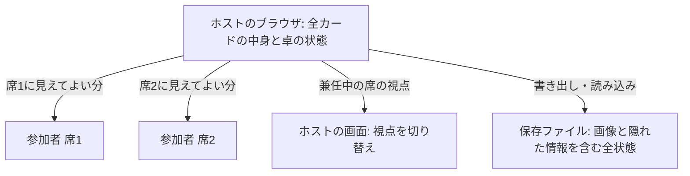
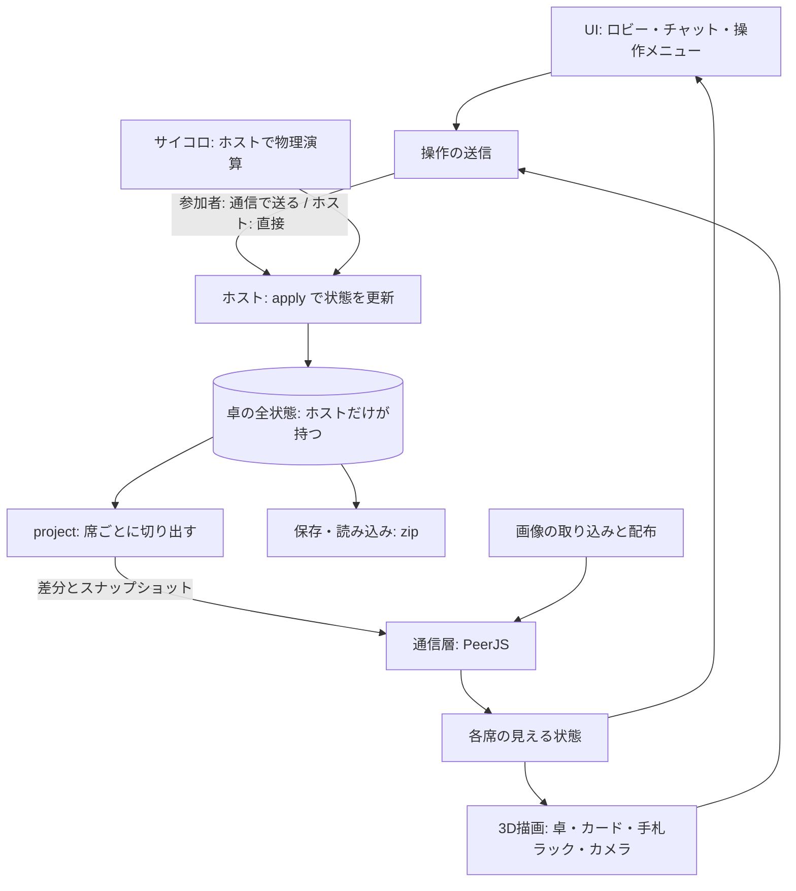
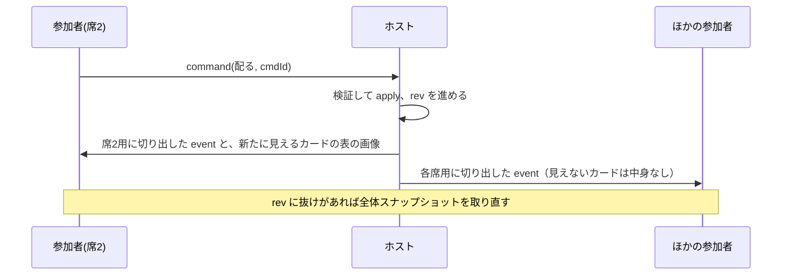
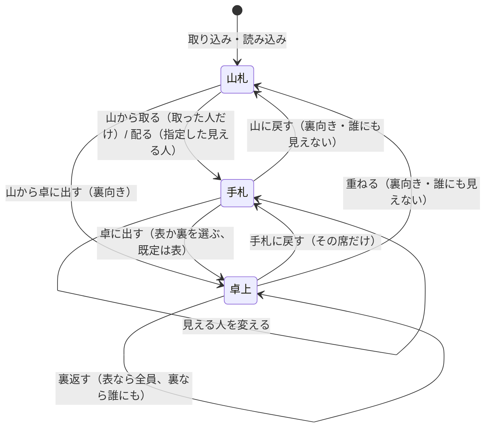
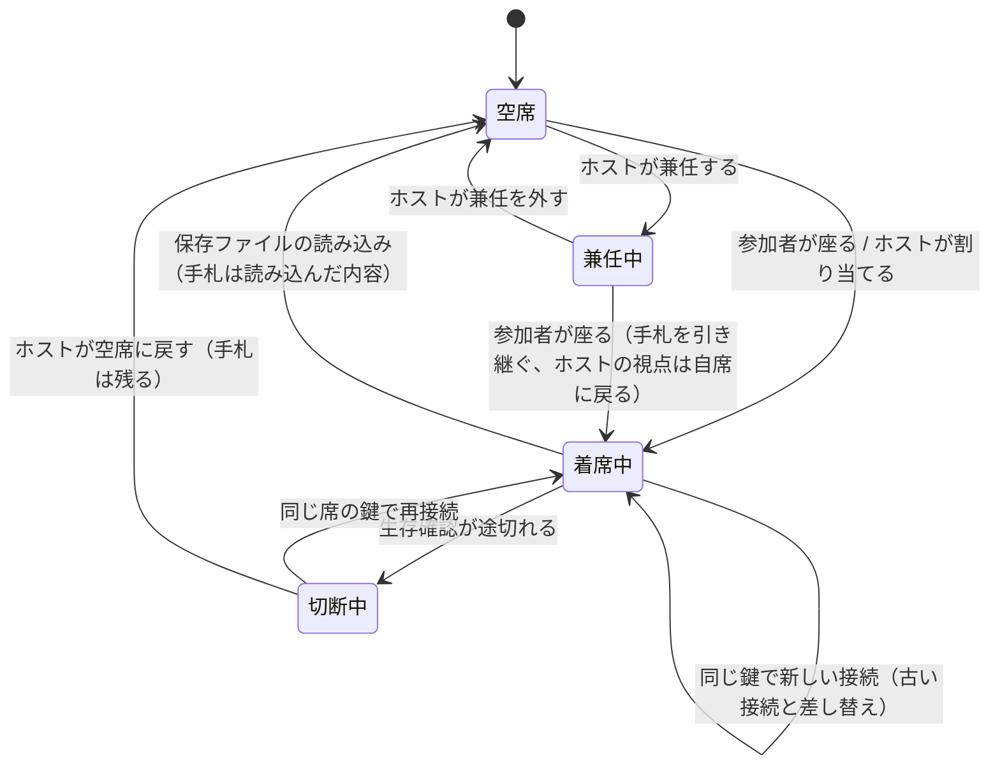

# ボドゲ試遊用3D卓（卓の基盤と同期） - Plan

## Goal Capsule

- **Objective:** 自作ボドゲを作っている人が、無料で、相手がいれば最大8人で、相手がいなければ一人で複数の席を動かして、試作のカード画像を使ったテストプレイをブラウザ上で行える。
- **Means:** ホストのブラウザだけが卓の状態を変え、各席には見えてよい分だけを切り出して PeerJS で送る（KTD2, KTD3）。
- **Product authority:** Product Contract が「何を作るか」を決める。Planning Contract は作り方を決め、Product Contract と食い違ったら Product Contract が優先する。駒の3Dモデル取り込み、手順の自動化、MCP による AI 席、試遊の再生は今回の範囲外（How This Work Fits Together を参照）。
- **Stop conditions:** 実装中に「見えないカードの中身を参加者に送らずには実現できない要件」が見つかったら、その要件の実装を止めて相談する（R7 が優先）。PeerJS の無料サーバーが使えず R13 を守れないと分かった場合も止めて相談する。
- **Execution profile:** 新規リポジトリでの一から実装。土台（U1〜U3）はテストを先に書く。3D 表示はブラウザで目視確認する。
- **Who finishes:** 実装は `ce-work`。見た目の確認はユーザーが開発サーバーで行う。
- **Open blockers:** なし。

---

## Product Contract

**Product Contract preservation:** changed: R5, R12 を書き換え、R19〜R28 を追加 — 計画時の点検で見つかった抜け（場所を移ったときの見える人、席の扱い、読み込み時の席、配る枚数不足、消す確認、シート取り込み、サイコロの種類、途中参加、ホストのタブ閉じ、接続失敗）をユーザーが確認した既定で埋めた。

### Summary

ブラウザで動く3Dの卓を作る。ホストが部屋を立て、最大8人が PeerJS でつながる。カード・盤面・駒・サイコロを置き、シャッフル・配る・見える人の切り替えを名前のある操作として行える。ホストは空いた席の視点に切り替えて、一人でも複数の席を動かせる。

### Problem Frame

自作ボドゲのテストプレイには、試作カードを並べて実際に回せる場が要る。Tabletop Simulator は有料で、試遊仲間全員に購入を求めることになる。さらに、相手が揃わない日は開発者が一人で試すことができず、試作を直してもすぐに回して確かめられない。

テストプレイは「直して、また遊ぶ」の繰り返しなので、毎回カード画像を取り込み直したり、卓を並べ直したりする手間がそのまま試遊の回数を減らす。

### Key Decisions

- **隠れた情報はホストのブラウザが管理し、参加者には見えてよい分だけを送る。** 参加者は開発者ツールで覗けない。ホスト自身は覗ける前提を受け入れる。Governs R7. (session-settled: user-approved — chosen over 見た目だけ隠す・暗号的シャッフル: 前者は参加者が覗け、後者は実装が重く操作の自由度も下がるため)
- **手札は3Dの卓上で、席の前に立てて並べる。** 実物の卓に一番近く、何枚持っているかが自然にわかる。Governs R6. (session-settled: user-directed — chosen over 画面下の2D手札バー・卓上の手札エリア: ラフ案3つを見比べて選んだ)
- **見える人は、カードがある場所で決まる。** 卓上は向き、手札は見える人、山札の中は誰にも見えない。誰に何が見えているかが一目で分かる。Governs R5, R19. (session-settled: user-approved — chosen over カードが見える人を持ち続ける・動かすたびに選ぶ: 前者は誰に何が見えているか分かりにくく、後者は操作が遅くなるため)
- **操作は、どのボドゲにも共通する基本操作の十数種類だけに名前をつける。** ゲームごとの動きは「移動」などの組み合わせで表し、ルールは強制しない。後で手順の自動化や AI 席を同じ操作の上に作れるようにする。Governs R2, R3. (session-settled: user-approved — chosen over 自由な卓・試遊の記録が中心の卓: 前者は自動化や AI 席のときに作り直しが出て、後者は今回の範囲が広がりすぎるため)
- **チャット欄の操作ログには意味のある操作だけを流す。** 単なる移動まで流すとログが読めなくなる。Governs R11. (session-settled: user-approved — chosen over 全操作を流す: ログが移動で埋まるため)
- **一人試遊は、ホストが空いた席を兼任して視点を切り替える形で行う。** 後で AI 席も同じ「席」の仕組みに乗せられる。Governs R14, R20. (session-settled: user-approved — chosen over タブを複数開くだけ・今回は不要)
- **カード画像の取り込みと、卓の状態のファイル保存は今回の範囲に含める。** これがないと自作ゲームのカードを卓に出せず、試遊の目的を果たせない。Governs R15, R16, R18, R24. (session-settled: user-approved — chosen over 文字のカードで代用・トランプだけ・ブラウザに自動保存)
- **1つの卓の上限は8人。** パーティーゲームや正体隠匿系も試せるようにする。Governs R9, R20. (session-settled: user-directed — chosen over 最大4人・最大2人: ホストの回線と負荷が増えることを承知で選んだ)

### Actors

- A1. ホスト: 部屋を立てる人。全カードの中身を知り、素材の取り込み・保存・読み込み・席の管理を行い、空いた席を兼任できる。多くの場合ゲームを作った本人。
- A2. 参加者: 部屋に入って1つの席に座る人。自分に見えてよい情報だけを受け取る。

### Requirements

**卓と物**

- R1. 3Dの卓の上に、カード、山札、盤面、駒、サイコロを置いて、視点を動かしながら操作できる。
- R2. 卓上の操作は名前のある基本操作として扱う。移動、回転、裏返す、重ねる（山にする）、山から取る、シャッフル、枚数を指定して配る、見える人を変える、サイコロを振る、卓に出す、卓から消す、を含む。
- R3. ルールは強制しない。どの席の人も、どのカード・駒・サイコロでも操作できる。
- R4. 駒は、既定の形と色から選んで卓に出せる。
- R25. サイコロは6面のものを使える。振った結果は全員に同じ動きと同じ出目で見える。

**見える範囲**

- R5. カードが誰に見えるかは、カードのある場所で決まる。卓上のカードは表向きなら全員、裏向きなら誰にも見えない。手札のカードは、そのカードの「見える人」（「全員」「誰にも見えない」「特定の席（複数可）」）に見える。山札の中のカードは誰にも見えない。
- R6. 席に配られたカードは、その席の前に立てて並ぶ。見える人には表が、見えない人には裏が見える。
- R7. ホストのブラウザが全カードの中身を管理する。参加者のブラウザには、その席に見えてよいカードの中身（画像を含む）だけが届く。
- R8. 配るときは、配る枚数、配り先の席、見える人を指定できる。見える人は「配り先だけ」「配り先以外」「誰にも見えない」「全員」から選べる。
- R19. 場所を移るときの見える人は次のとおり決まる。山から取ったカードは、取った人だけに見える手札になる。手札から卓に出すときは表か裏かを選べ、既定は表。山札に入れたカードと、シャッフルした山札のカードは、すべて裏向きで誰にも見えなくなる。
- R22. 配る枚数が山札に足りないときは、ある分だけ配り、足りなかったことをログで知らせる。

**部屋と同期**

- R9. ホストが部屋を立て、参加者は共有された招待（URL）で入れる。1つの部屋に最大8人まで入れる。
- R10. 誰かが卓を操作すると、ほかの全員の卓にもすぐ反映される。
- R11. 部屋の全員でテキストのチャットができる。チャット欄には操作ログも流れる。ログに流すのはシャッフル、配る、見える人の変更、サイコロ（出目を含む）、山から取る、手札から卓に出す、の操作で、単なる移動・回転・重ねるは流さない。ログには、その人に見えないカードの中身を書かない。
- R12. 参加者が切断しても、同じブラウザで再接続すれば同じ席に戻れる（席の扱いは R20）。ホストが抜けると部屋は終わる。
- R13. サーバー代のかからない構成で動き、使う人がお金を払わずに試遊できる。
- R26. 試遊の途中でも、空席があれば参加できる。
- R27. ホストがタブを閉じたり再読み込みしようとしたときは、部屋が終わることを警告する。
- R28. 部屋につながらないときは、つながらなかったことと考えられる原因（回線の制限など）を画面に出す。

**席と一人試遊**

- R14. ホストは空いた席を兼任でき、その席の視点に切り替えて、その席に見えるカードを見ながらその席として操作できる。
- R20. 席はホストの席を含めて最大8つ。ホストが兼任中の席には後から来た参加者が座れ、その席の手札はそのまま引き継がれる。ホストは、来なくなった参加者の席を空席に戻せ、手札はその席に残る。

**素材と保存**

- R15. ホストはカード画像を取り込んで山札を作れる。山札ごとに裏面の画像を1枚決められる。
- R24. カード画像は、1枚ずつのファイルからも、何行何列かを指定して1枚のシート画像を切り分けても取り込める。
- R16. ホストは盤面の画像を取り込み、大きな板として卓に置ける。
- R17. 取り込んだ画像は、ホストから各参加者へ配られる。参加者が自分で画像を用意する必要はない。カードの表の画像は、その人に見えてよくなった時点で届く（R7）。
- R18. ホストは、画像・配置・山札の順番・手札・見える人を含む卓の状態全体を1つのファイルに書き出せる。そのファイルを読み込めば同じ状態から再開できる。
- R21. 読み込むと全員の卓が入れ替わるので、実行前に確認を出す。読み込んだあとの席の割り当てはホストが行い、割り当てられなかった席の手札は空席にそのまま残る。
- R23. 「卓から消す」は確認してから消す。取り消し（undo）はない。



### Key Flows

- F1. 試遊の準備と開始
  - **Trigger:** ホストが新しい試作を試したい。
  - **Actors:** A1, A2
  - **Steps:** ホストが部屋を立てる。カード画像と盤面画像を取り込むか、前回の保存ファイルを読み込む。参加者は招待から入って席に座り、盤面と裏面の画像を受け取る。山札をシャッフルし、各席に配る。
  - **Covered by:** R9, R15, R24, R16, R17, R18, R2, R8
- F2. ひとり試遊
  - **Trigger:** 相手がいないが試作を回したい。
  - **Actors:** A1
  - **Steps:** ホストが部屋を立て、残りの席を兼任にする。配ったあと、席を切り替えながら各席の手札を見て操作する。
  - **Covered by:** R14, R6, R8
- F3. 試遊の途中保存と再開
  - **Trigger:** 試遊を中断したい、または同じ状態からルールを変えて試したい。
  - **Actors:** A1
  - **Steps:** ホストが卓の状態をファイルに書き出す。後日、部屋を立ててファイルを読み込み、参加者が入るとホストが席を割り当て、続きから遊べる。
  - **Covered by:** R18, R21, R12, R17

### Acceptance Examples

- AE1. **Covers R8, R6, R7.** **Given** 3人の卓で、**When** 席1が席2へ「配り先以外に見える」で2枚配ると、**Then** 2枚は席2の前に立ち、席1と席3には表、席2には裏が見え、席2のブラウザにはその2枚の中身も表の画像も届かない。
- AE2. **Covers R14, R6.** **Given** ホストが席1に座り席2を兼任していて、**When** 席2の視点に切り替えると、**Then** 席2に見えるカードが表、席2に見えないカードが裏で表示され、操作は席2として記録される。
- AE3. **Covers R7, R17, R12.** **Given** 配り終えた試遊の途中で、**When** 参加者が切断して同じブラウザで再接続すると、**Then** 同じ席に戻り、その席に見えてよいカードの中身だけを受け取る。
- AE4. **Covers R18, R21.** **Given** 手札と山札が残った状態でホストが書き出したファイルを、**When** 新しい部屋で読み込みホストが席を割り当てると、**Then** 配置、山札の順番、各席の手札、見える人が書き出し時と同じになる。
- AE5. **Covers R11.** **Given** 卓の上で、**When** 誰かが駒を動かすと、**Then** チャット欄には何も流れない。**When** 誰かがサイコロを振ると、**Then** 「誰が振ったか」と出目がチャット欄に流れる。
- AE6. **Covers R19, R5.** **Given** 席2の手札にある「席2だけに見える」カードを、**When** 席2が裏向きを選んで卓に出すと、**Then** 卓上で裏向きになり、誰のブラウザにも中身が届かない。**When** 誰かがそれを表に裏返すと、**Then** 全員に中身が届き表が見える。
- AE7. **Covers R19, R7.** **Given** 卓上に表向きのカードが混じった山札を、**When** シャッフルすると、**Then** すべて裏向きになり、どの参加者にも山札の並び順とカードの中身が届かない。
- AE8. **Covers R22.** **Given** 残り5枚の山札で、**When** 3席に2枚ずつ配ると、**Then** 5枚が配られ、1枚足りなかったことがログに流れる。
- AE9. **Covers R20.** **Given** ホストが席3を兼任して手札を3枚持たせているとき、**When** 新しい参加者が席3に座ると、**Then** その参加者は3枚の手札を引き継ぎ、ホストの兼任は外れる。

### Success Criteria

- 開発者が一人で、ホスト1席と兼任2席を使い、取り込んだカードで「シャッフル→配る→各席の手札確認」までを最後まで回せる。
- 8人が同じ卓に入り、操作が全員に反映される。
- 参加者のブラウザの開発者ツールで、自分に見えないカードの中身を確認できない。
- 使う人にも作る人にも、サーバーの月額費用がかからない。

<!-- ce-section: work-relationships -->
### How This Work Fits Together

この計画が扱うのは「卓の基盤」と「同期」だけ。以下は現時点での見通しで、決まったロードマップではない。

- 駒の3Dモデル取り込み
  - Depends on この計画の素材取り込みと保存の仕組み（R15〜R18）。
  - Can proceed independently of 手順の自動化、AI 席。
- 手順の自動化（シャッフル→配る→見える人を決める、の流れを登録して実行）
  - Depends on この計画の名前のある基本操作（R2）。
- MCP によるひとりテストプレイ（AI が他の席を操作する）
  - Depends on この計画の基本操作（R2）と席の兼任（R14）、見える分だけ渡す仕組み（R7）。
  - Still to decide: AI に渡す情報の形と、ローカル環境での動かし方。
- 試遊の記録と再生
  - Depends on この計画の基本操作（R2）。
  - Still to decide: 今回のログ（R11）の範囲を超えて、何を保存するか。

### Scope Boundaries

**Deferred for later**

- 駒の3Dモデル取り込み（今回は既定の形と色の駒で代用、R4）。
- 手順の自動化、MCP による AI 席、試遊の記録と再生。
- ホストが抜けたときの引き継ぎ。
- ブラウザへの自動保存（今回はファイルの書き出しと読み込みだけ）。
- 6面以外のサイコロ。

**Outside this product's identity**

- ゲームのルールを機械に理解させて強制すること。この卓はルールを守らせる場ではなく、人が試すための場。
- ホストからも中身を隠す暗号的なシャッフル。試遊仲間のうち、ホストは信頼する前提。
- 不特定多数とのマッチングや公開ロビー。招待した相手と遊ぶ道具として作る。

**Considered and not built**

- 参加者を追い出す機能: 招待した相手だけで遊ぶ前提で、招待 URL が漏れる危険は小さい。知らない人が入ってくる報告が出たら作る。
- 操作の取り消し（undo）: 「消す」の確認（R23）で一番痛い誤操作は防げる。試遊中に戻したい場面が多いと分かったら、操作ログ（KTD2）から作る。
- 無料の中継サーバー（TURN）: 今回は入れず、接続設定を差し替えられる形だけ用意する（KTD5）。つながらない組が実際に出たら、Cloudflare の無料枠で足す。
- 保存ファイルの版ごとの変換: 版は今1つしかなく、変換元がない。版番号と「新しすぎる版の拒否」だけを入れ、2つ目の版が必要になった時点で変換を足す。
- テクスチャの動的な読み込み・解放: カードは長辺1024px に縮め、通常の試遊のデッキは100枚程度なので、全カードのテクスチャを持っても足りる。200枚を超えるデッキで重いと分かったら、描画層の中で足す。

### Dependencies / Assumptions

- 部屋をつなぐときの仲介に、無料で使える PeerJS の公開サーバーを使う。稼働率や制限は公表されていない。使えなくなった場合は R13 を守る代替を検討する。
- 中継サーバーを使わないため、学校や会社の Wi‑Fi などでは、5組に1組ほどつながらない可能性がある（R28 で原因を表示する）。
- 参加者はみな PC のブラウザで参加する前提。スマホ対応は求めない。
- カード枚数が多く参加者が8人の場合、画像の配布に時間がかかり、ホストの回線に負荷がかかることを受け入れる。
- 保存ファイルには隠れた情報がすべて入るため、ファイルを開けば中身が見えることを受け入れる。

---

## Planning Contract

**Target repo:** 新規リポジトリ（未作成）。この計画ファイルも、そのリポジトリの `docs/plans/` に移す。

### Key Technical Decisions

- KTD1. **3D は three.js（WebGLRenderer）を素の TypeScript で使い、React は使わない。** 卓は操作の流れで状態が変わる命令型の場面で、数百枚のカードのドラッグに React の差分計算は不要。WebGPURenderer は多メッシュで遅い報告があるため避ける。three.js は 1.0 前なので版を固定する（0.187.0）。描画は薄い層に閉じ込め、状態のロジックから three.js を参照しない。
- KTD2. **卓の状態を変えるのはホストだけで、状態変更は純粋関数 `apply(state, command, rng)` に集める。** 参加者は操作（command）を送り、ホストが検証・適用して結果（event）を返す。イベントには通し番号（rev）をつけ、抜けを検知したら全体を取り直す。同じ `apply` を、後の自動化・AI 席・保存の読み込みからも呼べる。ドラッグ中の位置だけは例外で、操作した本人の画面で先に動かす。Governs R2, R3, R10.
- KTD3. **各席に送るデータは、1つの関数 `project(state, seat)` で切り出す。** 参加時・再接続時の全体スナップショットと、操作ごとの差分の両方に同じ関数を使い、二つの道筋がずれないようにする。カード ID はランダムで中身を表さず、シャッフルのたびに振り直す。山札の並びはホストの中だけにあり、参加者には枚数しか送らない。ログの文面も席ごとに作り、見えないカードの名前を入れない。Governs R5, R7, R11, R19.
- KTD4. **カードの表の画像は、その席に見えてよくなった時点で送る。** 盤面と裏面は参加時に送る。画像は内容のハッシュ（sha256）で識別して重複を省き、64KiB に分けて送る。接続が順序と再送を保証する（KTD5）ので、受信側での壊れ検知と再受信は作らない。送信が詰まったら待つ。届くまでのカードは「読み込み中」の表示にする。Governs R7, R17.
- KTD5. **通信は PeerJS 1.5.5（版を固定）を使い、接続は必ず `reliable: true` にする。** PeerJS の既定は順序を保証しないため、操作と画像が入れ替わって壊れる。部屋 ID はランダムな `tt-` 付きの文字列で、招待は `#room=` 付きの URL にする。接続設定（iceServers）は差し替えられるようにし、今回は STUN だけを使う。Governs R9, R13, R28.
- KTD6. **再接続は、参加者のブラウザに保存した「席の鍵」で同じ席に戻す。** 参加者の PeerJS ID は毎回変わってよい。2秒ごとの生存確認を10秒受け取れなければ切断とみなす。切断中も席と手札は残る。Governs R12, R20.
  - 鍵はタブごとの sessionStorage を主に使う（再読み込みでも残り、同じブラウザの別タブは別の参加者になる）。部屋ごとの鍵を localStorage にも控え、ホストから見てその席が切断中のときだけ取り戻しに使う。localStorage の鍵が着席中の席を指していたら、新しい参加者として扱う。
  - 着席中の席に正しい鍵で新しい接続が来たら（切断を検知する前の再読み込み）、古い接続を閉じて差し替え、全体スナップショットを送る。
  - 席に座っていない接続中の参加者（未着席）には、どの席にも属さない公開情報だけを `project` で切り出して送る。
- KTD7. **サイコロは、ホストが物理演算（Rapier, `@dimforge/rapier3d-compat` 0.21.0）で止まるまで計算し、出目と動きの記録（約30Hz）を全員に送る。** 参加者は記録を再生するだけで、物理演算を行わない。全員の端末で同じ結果を計算させる方式は、Rapier の通常版では保証されないため採らない。乱数の初期値はホストの `crypto.getRandomValues` で決める。Governs R25.
- KTD8. **保存ファイルは zip（fflate 0.8.3）で、`manifest.json`・`state.json`・`assets/<sha256>` を入れる。** `manifest.json` に形式の版を入れ、新しすぎる版は理由つきで拒否する。読み込み時は版、画像のハッシュ、大きさの上限を確かめ、壊れたファイルは読み込まずにエラーを出す。席の鍵は保存しない。Governs R18, R21.
- KTD9. **画像は取り込み時に縮めて WebP にする。** カードは長辺1024px、盤面は長辺4096px（端末のテクスチャ上限が小さければそれに合わせる）。WebP を作れないブラウザでは JPEG（透過があれば PNG）にする。シートは行数・列数を指定して切り分ける。Governs R15, R16, R24.
- KTD10. **カードをつかんでいる間は、ホストがそのカードに「つかんでいる席」を記録し、他の席はつかめない。** ドラッグ中の位置は約20Hz に間引いて送り、ログにもイベント番号にも入れない。手を離したときだけ「移動」操作として確定する。切断または5秒の無通信で、つかみを解く。Governs R3, R10.
- KTD11. **配信は GitHub Pages で行い、Vite の `base` を環境変数 `BASE_PATH` で切り替える。** ルーターは使わない。Governs R13.
- KTD12. **テストは Vitest で、状態の変化（`apply`）と切り出し（`project`）を中心に厚く書く。** 通信は、メモリ上でつないだ偽の通信路でホストと参加者をつなぐ結合テストで確かめる。3D の見た目は開発サーバーで目視する。

### High-Level Technical Design

**部品の関係**



**1つの操作の流れ**



**カードの場所と見える人（R5, R19）**



**席の状態（R12, R14, R20, R21）**



参加者側は「未着席（接続中・席なし）」から始まり、空席か兼任中の席を選んで座る。保存ファイルを読み込むと、全席が空席になり、接続中の参加者は全員未着席に戻る。読み込み後はホストが「割り当て完了」にするまで、参加者は自分で座れず、ホストが席を割り当てる（R21）。割り当てた時点で新しい席の鍵を発行する。

### Output Structure

```text
package.json
vite.config.ts
tsconfig.json
index.html
.github/workflows/deploy.yml
src/
  main.ts
  core/        状態・操作・apply・project・乱数（three.js と PeerJS を参照しない）
  net/         通信路（PeerJS と、テスト用のメモリ上の通信路）、部屋、席、生存確認
  assets/      画像の取り込み・縮小・シート切り分け・ハッシュ・分割送受信
  render/      three.js の場面、カード、手札ラック、ドラッグ、カメラ
  dice/        Rapier による振る計算と、動きの再生
  save/        zip の書き出し・読み込み・検証・版の変換
  ui/          ロビー、チャットとログ、操作メニュー、配るダイアログ、席の管理、接続エラー
tests/
  core/  net/  assets/  save/  dice/  render/  ui/
```

### Sequencing

U1 → U2 → U3 の順に土台を作る。その後、U4（通信）・U5（画像）・U6（3D）は並行して進められる。U7（サイコロ）は U6 のあとに、U9（保存）は U4 と U5 のあとに、U8（UI）は U4・U5・U6・U9 が揃ってから組む。

### Risks

| リスク | 影響 | 対策 |
|---|---|---|
| PeerJS の無料サーバーに稼働保証がない | 部屋を立てられない日がある | 接続先を設定で差し替えられるようにする（KTD5）。止まっていたら R28 の画面で知らせる |
| 中継なしでは一部の回線でつながらない | 学校・会社の Wi‑Fi の人が参加できない | R28 で原因を表示し、Cloudflare の無料 TURN を後から足せる形にする |
| カードが多いと GPU メモリが足りない | 200枚を超えると重くなる | 今回はカードを長辺1024px に縮めるだけにする。重いと分かったら、見えているカードだけ読み込む仕組みを描画層に足す |
| ホストのタブが裏に回ると処理が遅れる | 8人の操作の反映が遅れる | タブが裏に回ったらホストに警告を出す |
| Safari で WebP を作れない | 取り込んだ画像が壊れる | 機能を確かめ、使えなければ JPEG/PNG にする（KTD9） |
| PeerJS の更新が遅い | 将来のブラウザ変更で壊れる | 通信層を `src/net/` に閉じ込め、差し替えられるようにする |

### Sources / Research

- three.js マニュアル（WebGPURenderer）: https://threejs.org/manual/en/webgpurenderer 、多メッシュでの速度報告: https://discourse.threejs.org/t/webgpurenderer-2x-slower-cpu-and-5-10x-slower-first-frame-than-webglrenderer-on-many-mesh-scenes-r183-same-on-both-backends/91904
- PeerJS API（reliable の既定、ICE の既定）: https://peerjs.com/client/api/peer 、クラウドサーバー: https://peerjs.com/server/cloud
- Rapier の決定性: https://rapier.rs/docs/user_guides/javascript/determinism
- Cloudflare TURN の無料枠: https://developers.cloudflare.com/realtime/turn/faq/
- データチャネルの最大メッセージサイズ: https://developer.mozilla.org/docs/Web/API/RTCSctpTransport/maxMessageSize
- 直接接続の成功率（古い統計）: https://webrtchacks.com/usage-stats/
- fflate: https://github.com/101arrowz/fflate

---

## Implementation Units

### U1. プロジェクトの土台と配信

**Goal:** Vite + TypeScript のプロジェクトを作り、テストと GitHub Pages への配信が動く状態にする。

**Requirements:** R13

**Dependencies:** なし

**Files:**
- `package.json`
- `vite.config.ts`
- `tsconfig.json`
- `index.html`
- `src/main.ts`
- `.github/workflows/deploy.yml`
- `tests/smoke.test.ts`

**Approach:**
1. three 0.187.0、peerjs 1.5.5、@dimforge/rapier3d-compat 0.21.0、fflate 0.8.3 を版固定で入れる。
2. Vite の `base` を `BASE_PATH` で切り替える（KTD11）。
3. `deploy.yml` で main への push 時に GitHub Pages へ配信する。PR プレビューを入れるかは、リポジトリ作成後にユーザーの運用（gh-pages の pr-preview）に合わせて決める。

**Test scenarios:**
- Test expectation: none -- 土台の設定のみ。`tests/smoke.test.ts` は Vitest が動くことの確認だけ。

**Verification:** 開発サーバーで空のページが開き、テストとビルドが通る。

---

### U2. 卓の状態と基本操作（apply）

**Goal:** 卓の全状態の形と、十数種類の基本操作を適用する純粋関数を作る。

**Requirements:** R2, R3, R4, R8, R19, R22, R23（確認の UI は U8）, R10

**Dependencies:** U1

**Files:**
- `src/core/state.ts`
- `src/core/commands.ts`
- `src/core/apply.ts`
- `src/core/rng.ts`
- `src/core/log.ts`
- `tests/core/apply.test.ts`

**Approach:**
- 状態は「物（カード・山札・盤面・駒・サイコロ）」「席」「手札」「イベント番号」を持つ。カードの場所（山札・手札・卓上）と向きを持ち、見える人は場所から決める（R5, R19）。
- `apply` は検証（存在しない物、他の席がつかんでいる物）を行い、失敗は理由つきで返す（KTD2, KTD10）。
- シャッフルと配るはホストの乱数を使い、乱数は引数で渡してテストで固定できるようにする。
- ログ用の出来事は `apply` が返し、文面は U3 で席ごとに作る。

**Execution note:** 操作ごとに失敗するテストを先に書く。

**Test scenarios:**
- 山札10枚をシャッフルすると、同じ乱数の初期値なら同じ順番になり、10枚の集合は変わらない。
- Covers AE8. 残り5枚の山札で3席に2枚ずつ配ると5枚配られ、不足1枚の出来事が返る。
- 「配り先以外」で席2に2枚配ると、2枚は席2の手札に入り、見える人は席2以外の全席になる。
- 山から取ると、カードは取った席の手札に入り、見える人はその席だけになる。
- 手札から卓に裏向きで出すと、卓上で裏向きになる。向きを指定しなければ表向きになる。
- Covers AE7. 表向きのカードを含む山札をシャッフルすると、全カードが裏向きになる。
- 卓上のカードを山に重ねると裏向きになる。
- 他の席がつかんでいるカードを動かそうとすると失敗する。
- 消したカードを動かそうとすると「存在しない」で失敗する。
- 同じ cmdId の操作を2回送っても1回分しか適用されない。
- 単なる移動はログの出来事を返さず、サイコロ・配る・シャッフルは返す。

**Verification:** すべての基本操作が、3D も通信もない状態でテストから使える。

---

### U3. 席ごとの切り出し（project）

**Goal:** 全状態から、各席に送ってよい部分だけを切り出す関数と、差分を作る仕組みを作る。

**Requirements:** R5, R6, R7, R11, R14, R19

**Dependencies:** U2

**Files:**
- `src/core/project.ts`
- `src/core/diff.ts`
- `tests/core/project.test.ts`
- `tests/core/no-leak.test.ts`

**Approach:**
- `project(state, seat)` を、スナップショットと差分の両方に使う（KTD3）。
- 見えないカードは ID と「裏」だけにし、画像のハッシュも含めない。山札は枚数と一番上の情報だけにする。
- シャッフル後はカード ID を振り直し、前の ID と結びつけられないようにする。
- ホストの兼任中の視点は、`project` を兼任席で呼んだ結果をそのまま描画に使う（R14）。

**Execution note:** 漏れがないことのテストを先に書く。

**Test scenarios:**
- Covers AE1. 「配り先以外」で席2に配った2枚は、席2の切り出しに中身もハッシュも含まれず、席1と席3には含まれる。
- Covers AE6. 席2だけに見える手札を裏向きで卓に出すと、どの席の切り出しにも中身がない。表に裏返すと全席に中身が入る。
- Covers AE7. シャッフル後、どの参加者席の切り出しにも、山札の並び順と中身が含まれない。
- Covers AE2. ホストが兼任する席2で切り出すと、席2に見えるカードだけ中身が入る。
- ランダムな操作列を100通り流し、各時点で「その席に見えないカードの中身・ハッシュ」が切り出し結果の中に文字列として一度も現れないことを確かめる。
- スナップショットに差分を順に当てた結果が、最新のスナップショットと一致する。
- ログの文面に、見えないカードの名前が入らない。

**Verification:** 漏れなしのテストが通り、`project` 以外に参加者へ状態を渡す道がない。

---

### U4. 通信・部屋・席・チャット

**Goal:** PeerJS でホストと参加者をつなぎ、操作の送受信、席の鍵による再接続、チャットを動かす。

**Requirements:** R9, R10, R11, R12, R13, R20, R26, R27, R28

**Dependencies:** U3

**Files:**
- `src/net/transport.ts`
- `src/net/peerjs-transport.ts`
- `src/net/memory-transport.ts`
- `src/net/host.ts`
- `src/net/guest.ts`
- `src/net/seats.ts`
- `src/net/heartbeat.ts`
- `src/net/chat.ts`
- `tests/net/host-guest.test.ts`
- `tests/net/seats.test.ts`

**Approach:**
- 通信路は共通の型の後ろに置き、PeerJS 版とテスト用のメモリ版を差し替えられるようにする。
- PeerJS は `reliable: true` で接続する（KTD5）。部屋 ID はランダム、招待は `#room=` 付き URL。
- 参加者は未着席で入り、空席か兼任中の席を選んで座る。座った時点で席の鍵を発行し、保存先と再接続・差し替えの扱いは KTD6 に従う。
- 席の状態は HTD の「席の状態」に従う。最大8席（R20）。兼任が外れたら、ホストの視点と操作中の席を自席に戻して通知する。
- イベント番号の抜けを検知したら全体スナップショットを取り直す（KTD2）。
- ドラッグ中の位置は約20Hz に間引いて送る（KTD10）。
- ホストのタブ閉じ・再読み込みで警告を出す（R27）。接続できないときは原因の候補を返す（R28）。

**Test scenarios:**
- メモリ上の通信路で、ホストと参加者2人をつなぎ、参加者の「配る」操作が全員に反映される。
- Covers AE3. 参加者が切断して同じ席の鍵で再接続すると、同じ席に戻り、その席の切り出しだけを受け取る。
- 生存確認が切れる前に同じ鍵で再接続しても同じ席に戻り、古い接続には何も送られなくなる。
- 同じブラウザの2タブが、それぞれ別の席に座れる。
- 別の席の鍵では、その席に座れない。
- 未着席の参加者には、どの席の手札の中身も届かない。
- Covers AE9. ホストが兼任中の席に参加者が座ると、手札を引き継ぎ、兼任が外れ、ホストの操作中の席が自席に戻る。
- 5秒の無通信でつかみが解け、ほかの席がそのカードをつかめる。
- 9人目は満席で入れない。空席があれば試遊の途中でも入れる。
- ホストが切断中の席を空席に戻すと、手札は席に残る。
- 参加者側でイベント番号が1つ飛ぶと、スナップショットを取り直して状態が一致する。
- チャットの文字列は HTML として解釈されずに表示用データになる。
- 生存確認が10秒途切れると切断とみなし、つかんでいたカードが解放される。

**Verification:** メモリ版の結合テストが通り、2つのブラウザタブで PeerJS 経由の部屋に入れる。

---

### U5. 画像の取り込みと配布

**Goal:** カード・裏面・盤面の画像を取り込み、ハッシュで管理し、必要な時点で参加者へ分割して送る。

**Requirements:** R7, R15, R16, R17, R24

**Dependencies:** U3

**Files:**
- `src/assets/import.ts`
- `src/assets/sheet.ts`
- `src/assets/hash.ts`
- `src/assets/transfer.ts`
- `src/assets/store.ts`
- `tests/assets/sheet.test.ts`
- `tests/assets/transfer.test.ts`

**Approach:**
- 取り込み時に縮めて WebP にし、作れなければ JPEG/PNG にする（KTD9）。
- シートは行数・列数で切り分け、1枚ずつのカードにする（R24）。
- 画像は sha256 で識別し、64KiB に分けて送る（KTD4）。
- 表の画像は、`project` の差分で新しく見えるようになったハッシュだけを送る。盤面と裏面は参加時に送る。

**Test scenarios:**
- 3行×4列のシートを切り分けると、12枚のカード画像になり、それぞれの大きさが同じになる。
- 長辺2000px のカード画像は、長辺1024px に縮められる。
- 300KB の画像を分割して送ると、受信側で元のバイト列とハッシュが一致する。
- 席2に見えないカードの表の画像は、席2への送信予定に入らない。見えるようになった時点で入る。
- 同じハッシュの画像は2回送らない。

**Verification:** テストが通り、2タブで取り込んだカードを配ると、見える席にだけ表の画像が届く。

---

### U6. 3D の卓

**Goal:** 卓、カード、山札、盤面、駒を three.js で表示し、ドラッグ・回転・裏返し、手札の立て並べ、視点の切り替えを行える。

**Requirements:** R1, R4, R6, R14

**Dependencies:** U2（描画するのは U3 の切り出し結果）

**Files:**
- `src/render/scene.ts`
- `src/render/card-mesh.ts`
- `src/render/hand-rack.ts`
- `src/render/drag.ts`
- `src/render/camera.ts`
- `src/render/textures.ts`
- `tests/render/hand-layout.test.ts`

**Approach:**
- カードは1枚1メッシュにし、表裏の材質を切り替える（KTD1）。中身のないカードには裏面だけを貼る。
- 手札は席ごとのラックに立てて並べ、並び順だけから配置を計算する（同期するのは並び順だけ）。
- ドラッグは卓面と平行な平面との交点で動かし、離したときに操作を送る（KTD10）。離した場所で送る操作を決める。
  - 山札の上: 重ねる（R19 により裏向き）
  - 自席の手札ラックの上: 手札に戻す
  - それ以外の卓面: 移動
- ダブルクリックで裏返す。山札のクリックで山から取る。手札のカードは右クリックメニュー（U8）から卓に出す（表・裏を選ぶ）・見える人を変える。
- つかまれているカードは、つかんだ席の色の縁取りと席名で示す。他の席のドラッグは、届いた位置へ補間して動かす。
- 左ボタンはドラッグ、右・中ボタンは視点。席ごとの視点プリセットを持ち、兼任席に切り替えるとカメラもその席へ回る。今どの席として操作しているかを常に表示する。
- テクスチャは全カード分を保持する（動的な読み込み・解放は Scope Boundaries の Considered and not built）。

**Execution note:** 見た目の変更なので、開発サーバーを起動してユーザーのブラウザで開き、確認手順を添える。

**Test scenarios:**
- 手札5枚の配置計算で、5枚が席の前に重ならずに並び、席の方向を向く。
- 手札20枚でも、すべてのカードがラックの幅に収まる。
- 山札の上で離すと「重ねる」、自席のラック上で離すと「手札に戻す」、それ以外では「移動」の操作が作られる。
- 他は目視確認: 2タブで席1・席2から見て、席2の手札が席1からは裏、席2からは表に見える。

**Verification:** 開発サーバーで、カードをドラッグ・裏返し・手札化でき、視点切り替えで見え方が変わる。

---

### U7. サイコロ

**Goal:** 6面のサイコロを、ホストの物理演算で振り、全員に同じ動きと出目を見せる。

**Requirements:** R25, R11

**Dependencies:** U2, U6

**Files:**
- `src/dice/simulate.ts`
- `src/dice/playback.ts`
- `tests/dice/simulate.test.ts`

**Approach:**
- ホストが Rapier で止まるまで計算し、出目と約30Hz の動きの記録を「サイコロを振る」イベントで送る（KTD7）。
- 出目は、止まった姿勢で上を向く面から決める。斜めに止まったら軽く押して計算し直す。
- 参加者は記録を補間して再生するだけにする。

**Test scenarios:**
- 同じ乱数の初期値で振ると、同じ出目と同じ記録になる。
- 出目は1〜6の範囲に入る。
- 1000回振ると、各目の出る割合が極端に偏らない（各目 100〜240 回の範囲）。
- 記録の最後の姿勢から計算した出目が、送った出目と一致する。

**Verification:** 2タブで振ると、両方で同じ転がり方と同じ出目が見え、ログに出目が流れる。

---

### U8. UI（ロビー・チャット・操作メニュー・席管理）

**Goal:** 部屋の作成と参加、素材の取り込み、駒の選択、保存と読み込み、チャットとログ、操作メニュー、配るダイアログ、席の管理、接続まわりの画面を作る。

**Requirements:** R4, R8, R9, R11, R14, R15, R16, R18, R20, R21, R22, R23, R24, R26, R27, R28

**Dependencies:** U4, U5, U6, U9（取り込みと保存の画面は、U5・U9 の処理を呼ぶ）

**Files:**
- `src/ui/lobby.ts`
- `src/ui/import-dialog.ts`
- `src/ui/piece-picker.ts`
- `src/ui/save-load-panel.ts`
- `src/ui/chat-panel.ts`
- `src/ui/context-menu.ts`
- `src/ui/deal-dialog.ts`
- `src/ui/seat-panel.ts`
- `src/ui/connection-error.ts`
- `src/ui/toast.ts`
- `tests/ui/deal-dialog.test.ts`
- `tests/ui/context-menu.test.ts`

**Approach:**
- 取り込みダイアログで、1枚ずつのファイルかシート（行数・列数）を選び、山札ごとに裏面を決め、盤面を置く（R15, R16, R24）。
- 駒は形と色を選んで卓に出す（R4）。
- 保存・読み込みのボタンを置く。読み込み前に「全員の卓が入れ替わる」確認を出す（R18, R21）。
- 配るダイアログは、枚数・配り先の席・見える人（4択）を選び、1つの「配る」操作を送る（R8）。
- 右クリックメニューは対象（カード、手札のカード、山札、駒、サイコロ）ごとに項目を出す。手札のカードの「見える人を変える」は、全員・誰にも・席の複数選択から選ぶ（R5）。「消す」は確認を出す（R23）。
- 席のパネルで、兼任の開始と解除、席の切り替え、空席に戻す、未着席の参加者を席に割り当てる操作を行う。読み込み後は「割り当て完了」を押すまで参加者が自分で座れない（R14, R20, R21）。
- 操作が失敗したとき（他の席がつかんでいる、など）は、短い通知で理由を出す。通知はチャットログに流さない。
- 参加者側の状態画面: 満席（空席が出たらやり直せる）、部屋の終了（ロビーへ戻る）、再接続中（画面上部の帯で示し、操作を止める）、部屋が見つからない（招待 URL の確認を促す）、つながらない（R28）。
- ホストのタブが裏に回ったら警告を出す（Risks）。招待 URL をコピーできるようにする。

**Test scenarios:**
- 配るダイアログで「3枚・席2と席3・配り先だけ」を選ぶと、その内容の「配る」操作が1つ作られる。
- 枚数に0や負の数を入れると、送信できない。
- 「消す」を選んで確認で取り消すと、操作は送られない。
- 手札のカードの「見える人を変える」で席2と席3を選ぶと、その2席を見える人にする操作が1つ作られる。
- 読み込み後、「割り当て完了」の前は、参加者の「座る」操作が作られない。
- 他は目視確認: 一人でホスト席と兼任2席を使い、シャッフル→配る→各席の手札確認を最後まで回せる。

**Verification:** 成功基準の一人試遊が、開発サーバー上で最後まで回せる。

---

### U9. 保存と読み込み

**Goal:** 卓の全状態と画像を1つの zip に書き出し、読み込んで同じ状態から再開できるようにする。

**Requirements:** R18, R21

**Dependencies:** U2, U4（読み込み後の席と参加者の扱い）, U5

**Files:**
- `src/save/write.ts`
- `src/save/read.ts`
- `src/save/validate.ts`
- `tests/save/roundtrip.test.ts`
- `tests/save/validate.test.ts`

**Approach:**
- zip に `manifest.json`・`state.json`・`assets/<sha256>` を入れ、画像は無圧縮で格納する（KTD8）。
- 読み込みは版・ハッシュ・大きさの上限を確かめてから行い、確認ダイアログ（U8）のあとで全員の卓を入れ替える（R21）。
- 読み込み後の席と参加者の扱いは、HTD の「席の状態」の説明に従う（全席を空席に、参加者を未着席に戻し、ホストが割り当てる）。

**Test scenarios:**
- Covers AE4. 手札と山札が残った状態を書き出して読み込むと、配置・山札の順番・各席の手札・見える人が一致する。
- 画像のハッシュがファイル名と一致しない zip は、読み込みを拒否する。
- 形式の版が新しすぎるファイルは、読み込みを拒否して理由を出す。
- 席の鍵は保存ファイルに含まれない。
- 読み込み後、接続中の参加者は全員未着席になり、割り当てまでどの手札の中身も受け取らない。
- 読み込み後、参加者に送られる切り出しに、その席に見えないカードの中身が含まれない。

**Verification:** 書き出したファイルを新しい部屋で読み込み、続きから遊べる。

---

## Verification Contract

| 確認 | 方法 | 対象 |
|---|---|---|
| 型 | `npm run typecheck` | 全体 |
| 自動テスト | `npm test`（Vitest） | U2〜U5, U7〜U9 |
| ビルド | `npm run build`（`BASE_PATH` を指定して GitHub Pages 向けにも） | U1 |
| 漏れなし | `tests/core/no-leak.test.ts` が通る。さらに2タブで参加者側の受信データを開発者ツールで見て、見えないカードの中身がないことを確かめる | R7 |
| 目視 | 開発サーバーを起動し、ユーザーのブラウザで開いて確認手順を伝える | U6, U7, U8 |
| 一人試遊 | ホスト1席＋兼任2席で、取り込んだカードを使い「シャッフル→配る→手札確認」を回す | 成功基準 |
| 多人数 | 8タブ（またはそれに近い数）で同じ部屋に入り、操作が全員に反映される | R9, R10 |

## Definition of Done

- すべての R と AE が、テストまたは目視確認で満たされている。
- `npm run typecheck`、`npm test`、`npm run build` が通る。
- 漏れなしのテストが通り、参加者の受信データに見えないカードの中身がないことを確かめた。
- GitHub Pages に配信したページで、2台（または2ブラウザ）が部屋に入れる。
- 試して使わなかったやり方のコードや、デバッグ用の出力が残っていない。
- 各 U について: その U の Test scenarios がテストになって通り、Verification の状態になっている。
